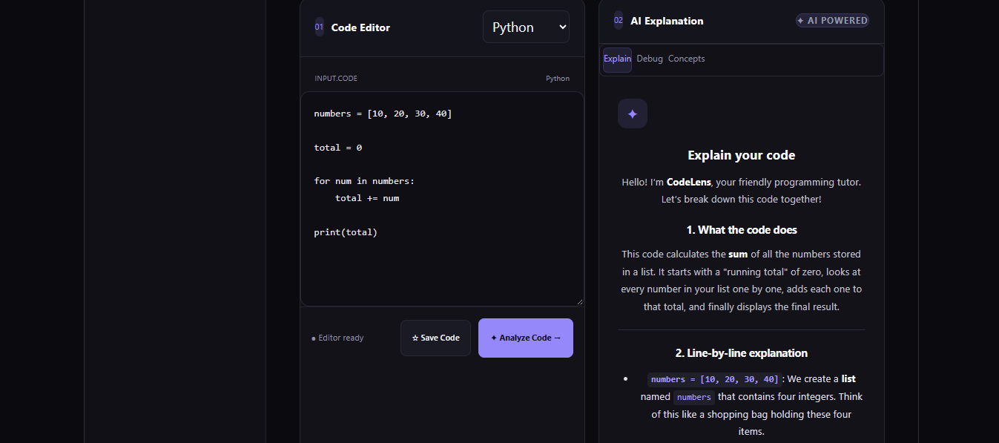
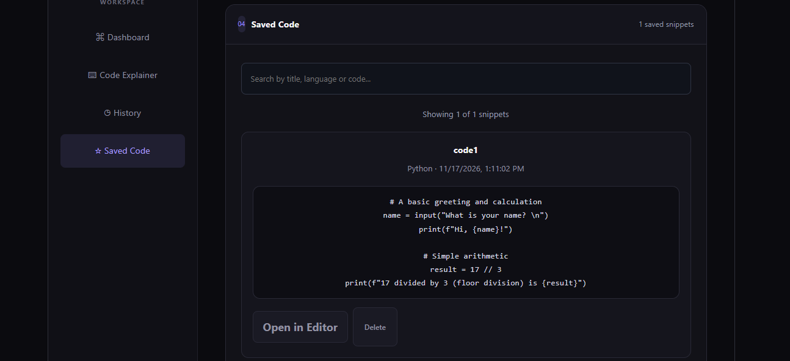

# CodeLens | AI-Powered Code Explanation & Learning Platform

CodeLens is an AI-powered code explanation and learning platform built with React, Node.js, Express, and Google Gemini AI. It helps developers understand code, identify potential bugs, and learn programming concepts through beginner-friendly AI explanations.

The platform supports guest access as well as optional user accounts, allowing registered users to securely store and synchronize their code analysis history and saved snippets using MongoDB Atlas.

## Live Demo

**Website:** https://code-lens-gpt-b975.vercel.app/

**GitHub Repository:** https://github.com/yashtiwari9320-a11y/CodeLens

## Features

### AI-Powered Code Analysis
- Explain code in simple, beginner-friendly language.
- Debug code and identify potential errors.
- Understand programming concepts, functions, and syntax.
- Receive structured AI-generated explanations.
- Powered by Google Gemini AI.

### User Authentication
- User registration and login.
- Password hashing using bcryptjs.
- JWT-based authentication.
- Secure access to account-specific data.
- Password visibility toggle.

### Guest and Account Modes
- Use CodeLens without creating an account.
- Guest data is stored locally in the browser.
- Registered users can synchronize their data with MongoDB Atlas.

### History Management
- Automatically save code analysis history.
- View previous explanations.
- Delete individual history records or clear history.
- Cloud synchronization for registered users.

### Saved Code
- Save code snippets with custom titles.
- Preserve the associated AI analysis.
- View and restore previously saved snippets.
- Store saved snippets in MongoDB for registered users.

### User Interface
- Dark and light themes.
- Responsive interface.
- Dedicated Dashboard, Code Explainer, History, Saved Code, and Settings sections.

## Technology Stack

| Category | Technologies |
|---|---|
| Frontend | React.js, Vite, CSS |
| Backend | Node.js, Express.js |
| Database | MongoDB Atlas |
| ODM | Mongoose |
| AI Integration | Google Gemini API |
| Authentication | JWT |
| Password Security | bcryptjs |
| Markdown Rendering | React Markdown, remark-gfm |
| Deployment | Vercel, Render |
| Version Control | Git, GitHub |

## Project Architecture

CodeLens uses a client-server architecture.

1. The React frontend communicates with the Express backend through REST APIs.
2. The backend processes code analysis requests using Google Gemini.
3. MongoDB Atlas stores registered users, history, and saved code.
4. JWT authenticates registered users and protects account-specific routes.
5. Guest users continue using browser LocalStorage.

## Screenshots

### Dashboard


### Code Explainer


### History


### Saved Code


## Getting Started

### Prerequisites

- Node.js and npm
- MongoDB Atlas account
- Google Gemini API key
- Git

### 1. Clone the Repository

```bash
git clone https://github.com/yashtiwari9320-a11y/CodeLens.git
cd CodeLens
```

### 2. Install Frontend Dependencies

```bash
npm install
```

### 3. Install Backend Dependencies

```bash
cd server
npm install
```

### 4. Configure Environment Variables

Create a `.env` file inside the `server` directory.

Add the following variables:

```env
GEMINI_API_KEY=your_gemini_api_key
MONGODB_URI=your_mongodb_connection_string
JWT_SECRET=your_generated_jwt_secret
```

Replace the example values with your own credentials.

**Important:** Never upload `.env` files or secret credentials to GitHub.

### 5. Start the Backend

From the `server` directory:

```bash
npm start
```

The backend will run on port 5000 locally.

### 6. Start the Frontend

Open another terminal at the project root:

```bash
npm run dev
```

Open the local URL displayed by Vite in your browser.

## Project Structure

```text
CodeLens/
│
├── public/
│
├── screenshots/
│
├── src/
│   ├── App.jsx
│   ├── App.css
│   └── assets/
│
├── server/
│   ├── middleware/
│   │   └── authMiddleware.js
│   │
│   ├── models/
│   │   ├── User.js
│   │   ├── History.js
│   │   └── SavedCode.js
│   │
│   ├── routes/
│   │   ├── auth.js
│   │   └── userData.js
│   │
│   ├── server.js
│   ├── package.json
│   └── .env
│
├── .gitignore
├── package.json
└── README.md
```

## Deployment

CodeLens is deployed using:

- **Frontend:** Vercel
- **Backend:** Render
- **Database:** MongoDB Atlas
- **AI Service:** Google Gemini API

The production frontend communicates with the deployed Express backend, while MongoDB Atlas provides persistent cloud storage for registered users.

## Learning Outcomes

Developing CodeLens provided practical experience in:

- Full-stack web development.
- React component-based development.
- REST API development using Express.js.
- MongoDB database integration using Mongoose.
- User authentication and authorization.
- Password hashing and JWT implementation.
- Third-party AI API integration.
- Cloud deployment and environment configuration.
- Git and GitHub version control.

## Future Enhancements

- Additional programming language support.
- Improved code analysis and debugging.
- Enhanced user account management.
- More advanced learning and code organization features.

## Author

**Yash Tiwari**

BSc Information Technology Student

GitHub: https://github.com/yashtiwari9320-a11y

LinkedIn: https://www.linkedin.com/in/yash-tiwari/
