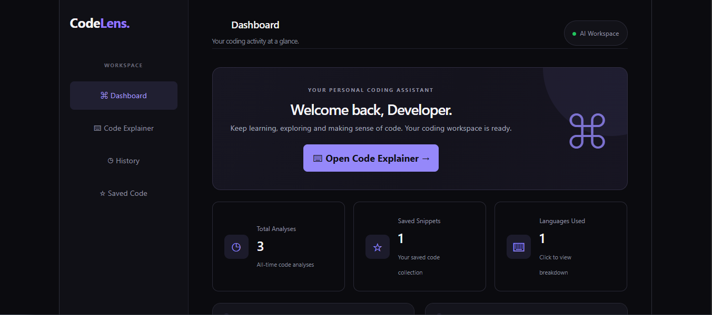
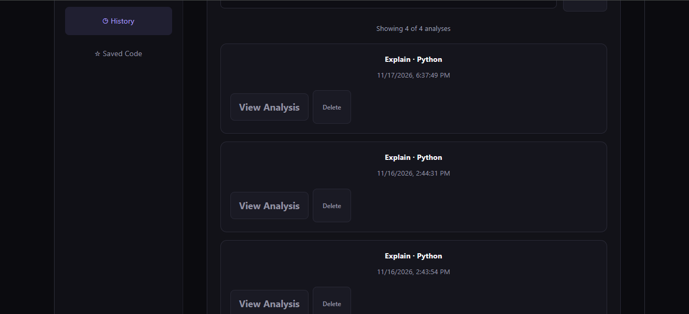

# CodeLens

### AI-Powered Code Explanation & Learning Platform

CodeLens is an AI-powered web application designed to help developers understand, analyze and improve their code. Powered by Google's Gemini AI, it provides code explanations, debugging assistance and concept-based learning through an interactive workspace.

<p align="center">
  <a href="https://code-lens-gamma-coral.vercel.app/">Live Demo</a> •
  <a href="https://github.com/yashtiwari9320-a11y/CodeLens">GitHub Repository</a> •
  <a href="https://github.com/yashtiwari9320-a11y">Developer Profile</a>
</p>

---

## Screenshots

### Dashboard


### Code Explainer


### Analysis History


### Saved Code


---

## Features

- **AI Code Explanation:** Understand code through clear, structured explanations.
- **Debugging Assistance:** Identify potential errors and receive suggestions to fix them.
- **Concept Learning:** Explore programming concepts related to submitted code.
- **Multi-language Support:** Work with Python, C, C++ and JavaScript.
- **Code Saving:** Save useful code snippets for future reference.
- **Analysis History:** Access previous code analyses.
- **Dashboard:** View analysis statistics, recent activity and saved snippets.
- **Personalized Settings:** Configure the default programming language and interface theme.
- **Responsive Interface:** Access the application across desktop and mobile devices.

## Tech Stack

| Technology | Purpose | Documentation |
|---|---|---|
| React | Frontend user interface | [React Docs](https://react.dev/) |
| Vite | Development and build tool | [Vite Docs](https://vite.dev/) |
| CSS | Styling and responsive layouts | [MDN CSS](https://developer.mozilla.org/en-US/docs/Web/CSS) |
| Node.js | Backend runtime | [Node.js Docs](https://nodejs.org/docs/latest/api/) |
| Express.js | Backend API | [Express Docs](https://expressjs.com/) |
| Google Gemini AI | AI-powered code analysis | [Gemini API Docs](https://ai.google.dev/gemini-api/docs) |
| LocalStorage | Client-side data persistence | [MDN Web Storage](https://developer.mozilla.org/en-US/docs/Web/API/Window/localStorage) |
| Vercel | Frontend deployment | [Vercel Docs](https://vercel.com/docs) |
| Render | Backend hosting | [Render Docs](https://render.com/docs) |
| Git & GitHub | Version control | [Git Docs](https://git-scm.com/doc) |

## Application Architecture

CodeLens follows a frontend-backend architecture.

1. The user enters code and selects a programming language.
2. The React frontend sends the request to the Express backend.
3. The backend communicates with Google's Gemini AI.
4. Gemini generates the requested analysis.
5. The backend returns the response to the frontend.
6. The application displays the result and stores relevant history locally.

## Getting Started

### Prerequisites

- [Node.js and npm](https://nodejs.org/)
- [Git](https://git-scm.com/)
- [Google Gemini API Key](https://aistudio.google.com/apikey)

### 1. Clone the Repository

```bash
git clone https://github.com/yashtiwari9320-a11y/CodeLens.git
```

### 2. Navigate to the Project

```bash
cd CodeLens
```

### 3. Install Frontend Dependencies

```bash
npm install
```

### 4. Configure the Backend

Open a separate terminal and navigate to the server directory:

```bash
cd server
npm install
```

Create a `.env` file in the server directory and configure your Gemini API key using the environment variable name expected by your backend source code.

**Security Note:** Never upload API keys or private environment files to GitHub.

### 5. Run the Application

Start the backend using its configured start command from the `server` directory.

Start the frontend in a separate terminal:

```bash
npm run dev
```

The frontend and backend should run separately using their respective development commands.

## Project Structure

```text
CodeLens/
│
├── server/
│   └── Backend files
│
├── src/
│   ├── App.jsx
│   ├── App.css
│   └── Other frontend files
│
├── public/
├── screenshots/
│   ├── dashboard.png
│   ├── code-explainer.png
│   ├── history.png
│   └── saved-code.png
│
├── package.json
└── README.md
```

## Key Learning Outcomes

Developing CodeLens provided practical experience in:

- Building responsive interfaces using React.
- Managing application state with React Hooks.
- Integrating third-party AI APIs.
- Developing backend APIs using Express.js.
- Connecting frontend and backend services.
- Managing application data with LocalStorage.
- Deploying applications using Vercel and Render.
- Using Git and GitHub for version control.

## Future Enhancements

- User authentication and personalized accounts.
- Support for additional programming languages.
- Code execution and output preview.
- Exportable analysis reports.
- Advanced code quality and optimization suggestions.

## Author

**Yash Tiwari**

BSc Information Technology Student

- **GitHub:** [Developer Profile](https://github.com/yashtiwari9320-a11y)
- **Project:** [CodeLens Repository](https://github.com/yashtiwari9320-a11y/CodeLens)
- **Live Application:** [CodeLens](https://code-lens-gamma-coral.vercel.app/)

---

*CodeLens is an educational project developed to make programming concepts easier to understand through AI-powered assistance.*